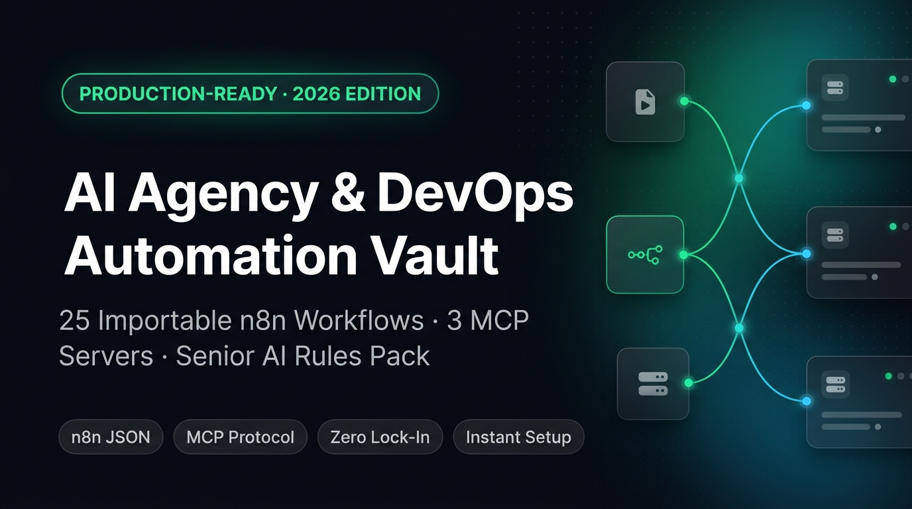

  

# ⚡ AI Agency & DevOps Automation Vault — Lite (Free Open-Source Edition)

Production-ready **n8n automation workflows** and a **zero-dependency Node.js MCP Server** built for developers, solo founders, and AI agencies.

- ✅ **Zero community plugin lock-in:** Uses only standard official n8n nodes (compatible with n8n Cloud & self-hosted).
- ✅ **OpenAI / OpenRouter / Claude / Ollama ready:** Configure `OPENAI_BASE_URL` & `OPENAI_MODEL` once.
- ✅ **Zero `npm install` MCP Server:** Pure Node.js stdio JSON-RPC 2.0 (`mcp-webhook-runner`).

---

## 📦 Included Free in This Repository (5 Workflows + 1 MCP Server)

| Workflow File | What It Automates | Edition |
| :--- | :--- | :--- |
| `01_ai_lead_enrichment_scoring.json` | AI Lead Enrichment & ICP Scoring Router | ✅ Free in Lite |
| `06_ai_ticket_triage_auto_draft.json` | AI Support Ticket Triage & Auto-Draft Reply | ✅ Free in Lite |
| `11_github_pr_ai_security_reviewer.json` | GitHub PR AI Security & Bug Reviewer | ✅ Free in Lite |
| `16_youtube_to_blog_linkedin_x_repurposer.json` | Transcript -> Blog Post + LinkedIn + X Thread Engine | ✅ Free in Lite |
| `21_daily_mrr_stripe_executive_briefing.json` | Daily Stripe Revenue & Refund Executive Briefing | ✅ Free in Lite |
| `mcp-servers/mcp-webhook-runner/` | Trigger & health-check n8n webhooks from Claude Code / Cursor / Antigravity | ✅ Free in Lite |

---

## 🚀 Want All 25 Production Workflows + 3 MCP Servers + Senior AI Rules Pack?

Upgrade to the **Full PRO Vault (v1.0 — $29 one-time, commercial agency license included)**:
- **25 ready-to-import n8n workflows** across Lead Gen & Sales, Customer Support & Ops, DevOps/GitHub Engineering, Content/SEO Growth, and Finance/Executive KPIs
- **3 working zero-dependency MCP servers** (`mcp-webhook-runner`, `mcp-github-triage`, `mcp-sqlite-analyst`)
- **4 Senior AI Engineering Rules & Audit Packs** (`CLAUDE.md` Next.js/TS, Python/FastAPI, OWASP Security Audit, PR Review Rubric)

👉 **[Get the Full PRO Vault on Gumroad →](https://danlopes3.gumroad.com/l/ai-automation-vault)**

---

## 🛠️ 60-Second Quickstart

1. Open n8n → **Add Workflow** → **`...`** → **Import from File...** → select any `.json` inside `n8n-workflows/`.
2. Check the yellow **Setup Guide** sticky note inside the canvas for required env vars (`OPENAI_API_KEY`, `SLACK_WEBHOOK_URL`, etc.).
3. To connect your AI coding assistant to n8n, see [`mcp-servers/mcp-webhook-runner/README.md`](./mcp-servers/mcp-webhook-runner/README.md).

## License
MIT License (Lite Edition). Built by [Daniel Lopes](https://github.com/danlopes18-ctrl).
